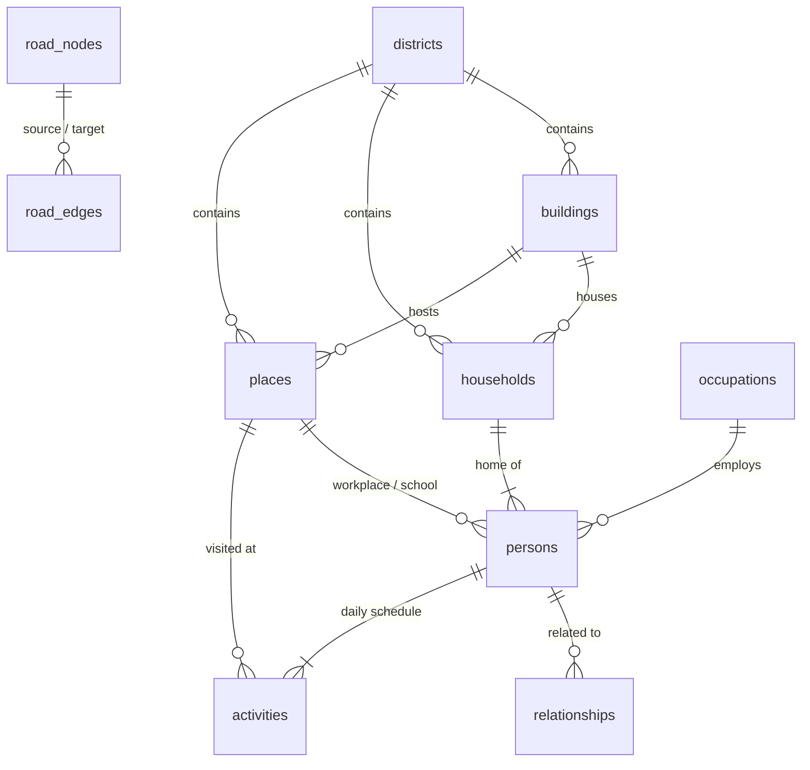

# MillionProfile

**One million synthetic residents of Birmingham, UK, in PostgreSQL. Each has a unique identity, a home, a family and a working day. You can explore them on a live WebGL map, an analytics dashboard and a read-only SQL console.**

The city is real: about 256k building footprints, 25k workplaces, shops, schools and other places, and a 26k-junction road network, all taken from OpenStreetMap. The people are synthetic. Each record is generated from distributions loosely calibrated to the 2021 Census for Birmingham.

| | |
|---|---|
| **Database** | PostgreSQL 17 + PostGIS 3.5 + pgRouting 3.8 (Docker) |
| **Data pipeline** | Python: pyosmium, GeoPandas, NumPy/SciPy, Faker, bulk `COPY` |
| **API** | FastAPI with hand-written SQL (psycopg 3, no ORM) |
| **Frontend** | React + TypeScript, deck.gl (WebGL), MapLibre, Recharts |

## What's in it

- **Map**: all 1,000,000 people drawn at once. Press play to watch a weekday unfold: people leave home, commute, work, run errands and come back. Select any dot to open that person's record, with their household, relatives at other addresses, daily schedule and their real road route, computed in SQL by pgRouting (`pgr_dijkstra`).
- **Analytics**: twelve documented queries in [`sql/analysis/`](sql/analysis), each rendered as a chart with a **SQL** tab showing the exact query. They cover window functions, `percentile_cont`, `FILTER` pivots, recursive CTEs, range joins against `generate_series`, geography distance and origin-destination matrices.
- **SQL console**: run any read-only query against the full dataset as a restricted `analyst` role (SELECT only, read-only transactions, 15 s timeout). Includes `EXPLAIN ANALYZE`.

## Data model



| Table | Rows (1M run) | Notes |
|---|---|---|
| `persons` | 1,000,000 | Unique citizen ID, email and signature colour. Name, DOB, appearance, education, job, income, commute mode |
| `households` | ~412k | Address (house/flat number, real street name, synthetic postcode), type, tenure |
| `relationships` | ~2M | Spouse, partner, parent, child, sibling, grandparent, grandchild, stored in both directions. Includes adult children who live at a different address |
| `activities` | ~3M | One weekday per person: ordered stops with start/end minute |
| `places` | ~25k | Real OSM shops, schools, universities, hospitals and offices, plus non-residential buildings as employers |
| `buildings` | ~256k | OSM footprints classified into residential, apartments, commercial and so on |
| `districts` | 55 | Voronoi cells around real OSM suburb names (Edgbaston, Moseley, Erdington…) |
| `road_nodes`, `road_edges` | 26k / 58k | Drivable OSM network for pgRouting |
| `mv_trips` | ~2M | Materialized view: consecutive activity pairs via `LEAD()` |
| `mv_district_stats` | 55 | Materialized view: population, density, median income, employment rate |

Bulk loading runs against bare tables. Constraints, indexes (GiST spatial, trigram name search, foreign keys) and materialized views are built afterwards in [`db/post_load.sql`](db/post_load.sql).

## Run it

Requires Docker Desktop (with about 6 GB of RAM allotted).

```bash
docker compose up -d db                                  # PostGIS + pgRouting
docker compose --profile generate run --rm generator    # download OSM + build 1M people (~5-10 min)
docker compose up -d api web                            # then open http://localhost:8080
```

- Different size or seed: `POPULATION=250000 SEED=7 docker compose --profile generate run --rm generator`. The pipeline is deterministic for a given seed.
- Connect any SQL client to `localhost:5433` as user `city` / password `city` (full access) or `analyst` / `analyst` (read-only), database `city`, schema `city`.
- After regenerating, restart the API (`docker compose restart api`) so it rebuilds the map snapshot.

### Local development

```bash
cd generator && uv run python -m src.main --population 50000 --osm ../data/osm --db-dir ../db
cd api && uv run uvicorn app.main:app --reload                # :8000
cd web && npm install && npm run dev                          # :5173, proxies /api
```

## How the simulation works

1. **Geography** (`generator/src/fetch_osm.py`, `geo.py`): extracts the Birmingham boundary, buildings, POIs, suburbs and drivable roads from the Geofabrik West Midlands extract. Buildings are classified, and each gets the nearest named street, with odd/even house numbers along it.
2. **People** (`people.py`): builds household compositions (singles, couples, families, single parents, multigenerational, shared houses), then ages, sexes and family links. Families share surnames drawn from eleven name locales. Full names are made unique, and every person gets a unique ID and colour. Employment, education, occupation and income depend on age. Jobs are assigned by a gravity model (local pull plus city-wide pull by employer size), pupils go to nearby schools, and commute mode depends on distance and household car ownership.
3. **Schedules** (`schedule.py`): fully vectorised. Shift patterns, school hours, errands and evenings out, with travel times from distance and mode.
4. **Load** (`load.py`): streams CSV into `COPY`, then runs `post_load.sql`.

The map gets everyone's day in one gzipped binary snapshot (`/api/sim/snapshot.bin`, about 20 MB). The browser interpolates a million positions per frame on the client, so playback never touches the database. Clicking a person fetches their full record and road route live.

## Data and licence notes

- Map data © OpenStreetMap contributors (ODbL). Basemap © CARTO.
- All people are fictional. Phone numbers use Ofcom's reserved drama range (07700 900xxx), and emails use the reserved `.example` domain.
