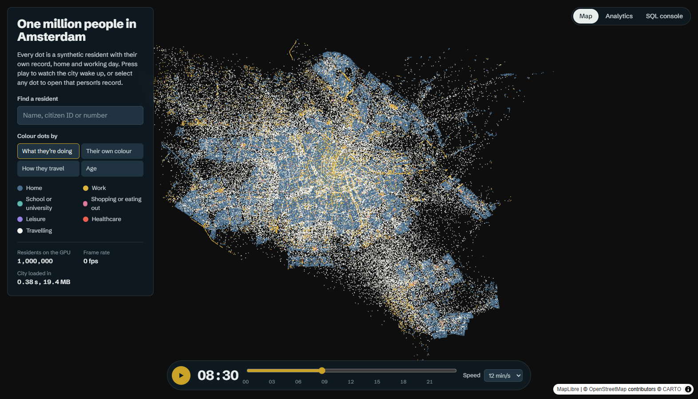
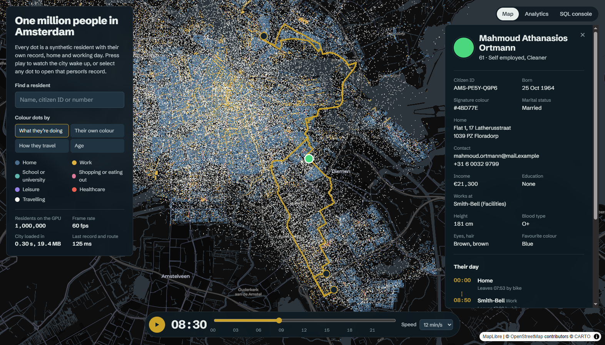
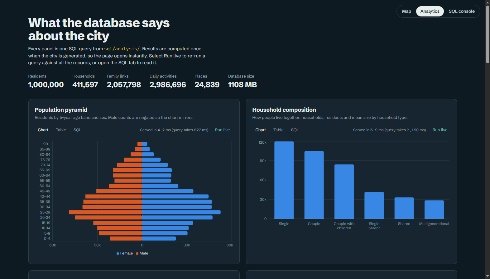
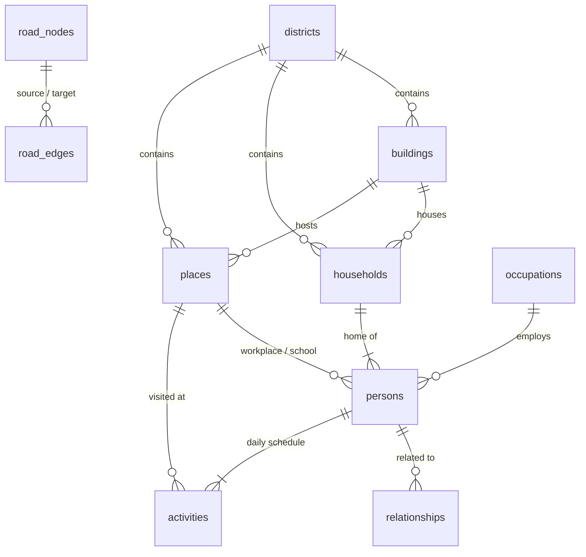

# MillionProfile

**One million synthetic residents of Amsterdam in PostgreSQL. Each has a unique identity, a home, a family and a working day. You can explore them on a GPU-simulated live map, an analytics dashboard and a read-only SQL console.**



| Resident record and road route | Analytics dashboard |
|---|---|
|  |  |

The city is real: about 138k building footprints, 25k shops, schools, offices and other places, and the drivable road network, all taken from OpenStreetMap. The people are synthetic: Western-international names, Dutch-format postcodes, euro incomes and a cycling-heavy commute.

| | |
|---|---|
| **Database** | PostgreSQL 17 + PostGIS 3.5 + pgRouting 3.8 (Docker) |
| **Data pipeline** | Python: pyosmium, GeoPandas, NumPy/SciPy, Faker, bulk `COPY` |
| **API** | FastAPI with hand-written SQL (psycopg 3, no ORM), in-memory SciPy routing |
| **Frontend** | React + TypeScript, deck.gl with a custom WebGL layer, MapLibre, Recharts |

## What's in it

- **Map**: all 1,000,000 people, simulated on the GPU. Press play to watch a weekday unfold: people leave home, commute by bike, tram, metro or car, work, run errands and come back. Select any dot to open that person's record: household, relatives at other addresses, daily schedule and their road route.
- **Analytics**: twelve documented queries in [`sql/analysis/`](sql/analysis), each rendered as a chart with a **SQL** tab showing the exact query. They cover window functions, `percentile_cont`, `FILTER` pivots, recursive CTEs, range joins against `generate_series`, geography distance and origin-destination matrices. Results are precomputed at generation time. **Run live** re-executes a query over all the records and reports its timing.
- **SQL console**: run any read-only query against the full dataset as a restricted `analyst` role (SELECT only, read-only transactions, 15 s timeout, session reset between users). Includes a pgRouting example and `EXPLAIN ANALYZE`.

## Performance

The rule of thumb: **nothing a visitor does should touch more data than it shows.**

| What | How | Measured (1M people) |
|---|---|---|
| Animating the whole city | Each person's day sits in static GPU buffers. A custom deck.gl layer's vertex shader works out every position and colour from a single `time` uniform, so a frame costs one uniform write with no CPU loop and no buffer upload. Points are opaque sprites with blending off. | **45–60 fps** at 1M, **45–60 fps** at 5M, **20–60 fps** at 10M agents (`?scale=N` benchmark), measured in Chrome on an integrated AMD Radeon laptop GPU |
| Loading the city | The generator writes the snapshot as 8 quantised, columnar chunks (32 bytes per person, unorm16 coordinates and times). It's pre-gzipped and served by nginx as immutable static files. Chunks download in parallel and each renders as soon as it lands. Typed arrays are views straight into the downloaded buffer and go to the GPU as-is. | 19.4 MB total, **0.3–0.8 s** cold, **0.2 s** cached |
| Opening a record | 4 indexed lookups on one pooled connection | **15–40 ms** |
| Road route | Road graph loaded once into SciPy sparse matrices: fastest route for drivers, shortest motorway-free route for walkers and cyclists. Dijkstra runs in C. | **7–17 ms** (was 260 ms with per-request `pgr_dijkstra`) |
| Analytics page | Results precomputed into `analytics_results` (jsonb) | **< 10 ms** per chart (live queries take 0.2–5 s) |
| Name / ID search | GIN trigram index | **~40 ms** |
| Generating the city | Vectorised NumPy, buffered RNG in the household loop (was 289 s, now 35 s), `COPY` bulk load, indexes built after load with parallel workers | **~2 min** natively, **~7 min** inside Docker Desktop, for 1M people end to end |

The frame rate and load time are shown live in the map's side panel.

## Data model



| Table | Rows (1M run) | Notes |
|---|---|---|
| `persons` | 1,000,000 | Unique citizen ID (`AMS-XXXX-XXXX`), email and signature colour. Name, DOB, appearance, education, job, income, commute mode |
| `households` | ~410k | Address (house/flat number, real street name, `1017 AB`-style postcode), type, tenure |
| `relationships` | ~2M | Spouse, partner, parent, child, sibling, grandparent, grandchild, stored in both directions. Includes adult children who live at a different address |
| `activities` | ~3M | One weekday per person: ordered stops with start/end minute |
| `places` | ~25k | Real OSM shops, schools, universities, hospitals and offices, plus non-residential buildings as employers |
| `buildings` | ~138k | OSM footprints classified into residential, apartments, commercial and so on |
| `districts` | 48 | Voronoi cells around real OSM neighbourhood names (Jordaan, De Pijp, Oostelijk Havengebied…) |
| `road_nodes`, `road_edges` | 23k / 52k | Drivable OSM network, kept slightly beyond the boundary so every district stays connected (largest strongly connected component) |
| `mv_trips` | ~2M | Materialized view: consecutive activity pairs via `LEAD()` |
| `mv_district_stats` | 48 | Materialized view: population, density, median income, employment rate |
| `analytics_results`, `meta` | – | Precomputed dashboard results; city config and per-step generation timings |

Bulk loading runs against bare tables. Constraints, indexes (GiST spatial, trigram name search, foreign keys) and materialized views are built afterwards in [`db/post_load.sql`](db/post_load.sql).

## Run it

Requires Docker Desktop (with about 6 GB of RAM allotted).

```bash
docker compose up -d db                                  # PostGIS + pgRouting
docker compose --profile generate run --rm generator    # download OSM + build 1M people (~7 min in Docker)
docker compose up -d api web                            # then open http://localhost:8080
```

- **Another city**: cities are one entry each in [`generator/src/cities.py`](generator/src/cities.py) (OSM source, projection, address and phone formats, currency, pay level, travel behaviour, housing density). Amsterdam is the default and Birmingham is included as a second example: `CITY=birmingham docker compose --profile generate run --rm generator`.
- **Size and seed**: `POPULATION=250000 SEED=7 docker compose --profile generate run --rm generator`. Output is deterministic for a given seed.
- **Database access**: connect any SQL client to `localhost:5433` as `city` / `city` (full access) or `analyst` / `analyst` (read-only), database `city`, schema `city`.
- **After regenerating**: run `docker compose restart api` to reload the road graph and cached counts. Snapshot files are content-hashed, so browsers pick up new ones automatically.
- **Deep links**: `http://localhost:8080/?person=4242&t=12:30` opens a resident's record at a given time. `?scale=5` runs the GPU benchmark with 5× the population.

### Local development

```bash
cd generator && uv run python -m src.main --population 50000 --data ../data --db-dir ../db --sql-dir ../sql/analysis
cd api && uv run uvicorn app.main:app --reload                # :8000
cd web && npm install && npm run dev                          # :5173, proxies /api
```

## How the simulation works

1. **Geography** ([`fetch_osm.py`](generator/src/fetch_osm.py), [`geo.py`](generator/src/geo.py)):
   - Extracts the city boundary, buildings, places, neighbourhood names and drivable roads from the Geofabrik regional extract.
   - Classifies each building and gives it the nearest named street, with odd/even house numbers along it.
2. **People** ([`people.py`](generator/src/people.py)):
   - Builds household compositions (singles, couples, families, single parents, multigenerational, shared houses), then ages, sexes and family links.
   - Families share surnames drawn from Western name locales. Full names are made unique, and every person gets a unique ID and colour.
   - Homes are allocated by floor area per dwelling, so canal-side blocks hold several households and houses hold one.
   - Employment, education, occupation and income depend on age and a district affluence effect.
   - Jobs come from a gravity model (local pull plus city-wide pull by employer size). Commute mode follows the city's travel profile, distance and car ownership.
3. **Schedules** ([`schedule.py`](generator/src/schedule.py)): fully vectorised. Shift patterns, school hours, errands and evenings out, with travel times from distance and mode.
4. **Snapshot** ([`snapshot.py`](generator/src/snapshot.py)): the binary chunks the GPU layer reads. Layout is mirrored in [`web/src/sim.ts`](web/src/sim.ts) and the shader in [`web/src/layers/SimLayer.ts`](web/src/layers/SimLayer.ts).
5. **Load** ([`load.py`](generator/src/load.py)): streams CSV into `COPY`, runs `post_load.sql`, then precomputes every analysis query.

## Data and licence notes

- Map data © OpenStreetMap contributors (ODbL). Basemap © CARTO.
- All people are fictional. Phone numbers use the unallocated Dutch `06-0` mobile block, and emails use the reserved `.example` domain.
